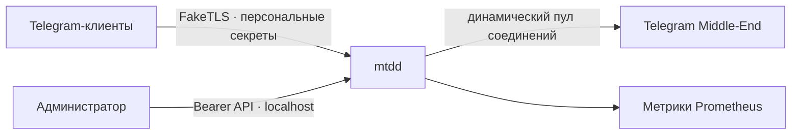

<div align="center">


**MTProto-прокси для Telegram.** Один бинарник, несколько пользователей,
FakeTLS, управление через API и динамический пул подключений к Telegram.


<a href="https://github.com/ugDeDe/mtdd/releases"></a>


<p><sub>Бейдж <code>downloads</code> считает скачивания файлов всех релизов GitHub
(assets), включая повторные установки, обновления и служебные файлы. Это не
число уникальных установок; телеметрии в mtdd нет.</sub></p>

**[🚀 Установка](#быстрый-старт)** · **[🎛️ Лаунчер](#лаунчер-управления)** · **[⚙️ Настройки](docs/CONFIG.md)** · **[🔑 API и ссылки](#управление-и-наблюдение)** · **[📚 Техдокументация](docs/TECHNICAL.md)** · **[❓ FAQ](#faq)**

</div>

---

## Содержание

- [Что умеет mtdd](#возможности)
- [Производительность](#производительность)
- [Как это работает](#как-это-работает)
- [Установка и обновление](#быстрый-старт)
- [Лаунчер управления](#лаунчер-управления)
- [Конфигурация](#конфигурация) · [справочник параметров](docs/CONFIG.md)
  - [Высокая нагрузка](#высокая-нагрузка)
- [API, пользователи и метрики](#управление-и-наблюдение)
- [Сборка и проверка](#сборка-и-проверка)
- [Безопасность](#безопасность)
- [FAQ](#faq)
- [Лицензия](#лицензия)

---

## Возможности

- FakeTLS и обфускация MTProto; глобальный рекламный тег Telegram.
- Независимые event-loop workers и ограничение числа подключений и памяти.
- Динамический пул соединений с Middle-End для каждого подписанного DC.
- Локальный HTTP API: пользователи, отзыв сессий, состояние и метрики.
- Политики пользователей: срок действия, квота трафика, лимиты IP, устройств
  и скорости.
- Шейпинг медиа: отдельные правила для загрузок и выгрузок, выбор медиа-DC,
  запас на всплеск для коротких передач, честное деление между пользователями;
  правила меняются без перезапуска.
- Лаунчер управления: интерактивное меню и подкоманды для службы,
  пользователей, ссылок и метрик — без ручного `curl`.
- Проверка повторов, тайм-ауты, восстановление соединений и плавное завершение.
- Опциональный переход на прямой DC для выбранных DC; при этом рекламный тег
  Middle-End не передаётся.
- Сборка одного статического бинарника Linux x86-64.

## Производительность

mtdd работает в продакшене под реальными клиентами: логины, сообщения и
медиа, тысячи одновременных подключений на ноду. Сравнение с
[telemt](https://github.com/telemt/telemt) 3.5.17 проводилось на четырёх
одинаковых VPS (Intel Xeon Gold 6240R, 2 vCPU, 2 ГБ, одна подсеть) с живыми
клиентами одного пула; CPU, память и трафик снимались средствами ОС, а не
метриками самих прокси.

| В среднем за ~2 часа | mtdd | telemt 3.5.17 |
| --- | --- | --- |
| CPU прокси на 1 Гбит/с | 1.04–1.06 ядра | 5.55–6.17 ядра |
| Память (RSS) на 1000 соединений | 27–28 МиБ | 133–137 МиБ |
| Трафик на 1000 соединений | 66–70 Мбит/с | 11–12 Мбит/с |
| Ретрансмиты TCP | 1.3–1.6 % | 3.1–3.2 % |

На одинаковом трафике около 300 Мбит/с telemt тратил примерно вдвое больше
CPU и в 2.5–3 раза больше памяти; на пике около 1 Гбит/с mtdd расходовал
0.76–0.79 ядра на гигабит. Стенд, протокол измерения, минимумы и максимумы
по всем параметрам и ограничения — в
[docs/mtdd-telemt-comparison.md](docs/mtdd-telemt-comparison.md);
сборщик для повторения замеров — [tools/proxymon](tools/proxymon).

## Как это работает



Клиент подключается по персональной ссылке. Прокси проверяет секрет, передаёт
трафик через Middle-End и по мере нагрузки регулирует число соединений в пуле.
API управления и метрики защищены отдельным токеном; по умолчанию они доступны
только на сервере.

Подробное описание архитектуры, принципа работы с Middle-End, бюджета памяти,
загрузки процессора и преимуществ реализации — в технической документации
[docs/TECHNICAL.md](docs/TECHNICAL.md).

---

## Быстрый старт

Нужны Linux x86-64, systemd, `curl`, `python3`, `sha256sum` и доступ к
GitHub. По умолчанию установщик использует репозиторий `ugDeDe/mtdd`;
для форка или зеркала репозиторий задаётся через `--repo OWNER/REPO`.

Установщик скачивается из репозитория проекта. Скрипт выполняется от root,
поэтому его содержимое и источник следует проверить до запуска:

```bash
curl -fsSLo install.sh https://raw.githubusercontent.com/ugDeDe/mtdd/main/install.sh
sudo bash install.sh
```

Или интерактивный установщик запускается одной командой:

```bash
curl -fsSL https://raw.githubusercontent.com/ugDeDe/mtdd/main/install.sh | sudo bash
```

Вопросы читаются из терминала, поэтому этот вариант работает и через pipe.

В интерактивном режиме выберите канал сборки и введите FakeTLS-домен и
32-символьный шестнадцатеричный рекламный тег Telegram, затем подтвердите или
измените порт, имя пользователя и обнаруженный адрес. После установки
программа покажет готовую ссылку для подключения — откройте её в Telegram.
Установщик пытается определить публичный IPv4 через `api.ipify.org`; если это
не удалось, он запросит адрес. При NAT или использовании DNS укажите внешний
адрес явно: `sudo bash install.sh --public-host proxy.example.com`.

Пример диалога (значения и ссылка сокращены):

```text
  ━━━━━━━━━━━━━━━━━━━━━━━━━━━━━━━━━━━━━━━━━━━━━━━━━━━━
  mtdd · установка MTProto-прокси
  ━━━━━━━━━━━━━━━━━━━━━━━━━━━━━━━━━━━━━━━━━━━━━━━━━━━━
  Каналы: main — основной, dev — тестовый
  → Канал сборки (main/dev) [main]:

  Настройка прокси
  → Домен FakeTLS: example.org
  → Рекламный тег Telegram (32 hex): …
  → TCP-порт прокси [443]:
  → Имя первого пользователя [admin]:
  → Публичный IP или DNS сервера [203.0.113.10]:

  ✓ Бинарник: main · служба: mtdd
  ✓ Менеджер управления: sudo mtdd-ctl (/usr/local/bin/mtdd-ctl)
  ! Ссылки содержат секреты. Передавайте их только своим пользователям.
  admin: https://t.me/proxy?server=203.0.113.10&port=443&secret=…
```

`Enter` принимает значение в квадратных скобках. Цвета включаются только для
терминала; переменная `NO_COLOR` отключает их. При обновлении существующие
пользователи и секреты не генерируются заново. Если установщик запущен через
pipe (`curl … | sudo bash`), копия `mtdd-ctl` не создаётся — управление
выполняется тем же скриптом.

Ссылка содержит секрет пользователя и равнозначна паролю: её не публикуют и
передают только пользователю, которому разрешён доступ. Вывод установщика со
ссылками не следует публиковать в общедоступных журналах.

> **Перед установкой:** нужны отдельный рекламный тег Telegram, домен
> маскировки FakeTLS и свободный, доступный извне TCP-порт. Установщик не
> меняет правила firewall и DNS-записи.

### Установка с параметрами

Укажите обязательные параметры; для серверов за NAT дополнительно задайте
публичный адрес и порт, доступные клиентам:

```bash
sudo bash install.sh \
  --branch main --domain example.com \
  --ad-tag 0123456789abcdef0123456789abcdef --port 443 --user admin \
  --public-host proxy.example.com --public-port 443
```

`--domain` — домен маскировки FakeTLS, а `--public-host` — адрес самого
прокси; это не обязательно один и тот же домен. В DNS публичное имя должно
указывать на сервер. `--port` задаёт локальный порт прослушивания,
`--public-port` — внешний порт в ссылке, если он отличается. Входящий
TCP-трафик на внешний порт разрешается в сетевом экране; при NAT настраивается
переадресация. Без `--public-port` используется локальный порт. Если
`--public-host` не указан, установщик попробует определить публичный IPv4
автоматически. Когда все обязательные значения заданы или определены,
установщик работает без вопросов. Если обязательных значений не хватает, он
запросит их в терминале; при запуске без терминала сообщит, какие параметры
нужно добавить.

### Параметры установщика

| Параметр | Назначение |
| --- | --- |
| `--branch main\|dev` | Канал бинарника: стабильная ветка `main` или тестовая `dev` |
| `--version X.Y.Z` | Конкретный релиз `main` вместо последнего (откат, фиксация версии) |
| `--domain HOST` | Домен FakeTLS для новой установки |
| `--ad-tag HEX` | Рекламный тег Telegram, 32 hex-символа; необязателен (без него — прокси без спонсорского канала) |
| `--port PORT` | Локальный TCP-порт прокси, по умолчанию 443 |
| `--public-host HOST` | Публичный IPv4, IPv6 или DNS для ссылок; по умолчанию определяется IPv4 |
| `--public-port PORT` | Публичный порт для ссылок при NAT; по умолчанию локальный порт |
| `--user NAME` | Имя первого пользователя, по умолчанию `admin` |
| `--repo OWNER/REPO` | Репозиторий GitHub с релизами |
| `--base-url URL` | HTTPS-зеркало каталога релизов |
| `--binary-only --output PATH` | Скачать только бинарник без настройки системы |
| `--help` | Показать справку |

```bash
# Тестовая сборка с интерактивной настройкой
sudo bash install.sh --branch dev

# За NAT: снаружи 443, локально 14443
sudo bash install.sh --port 14443 --public-port 443 --public-host proxy.example.com

# Справка без установки
bash install.sh --help
```

Установщик проверяет SHA-256 скачанного бинарника, создаёт системного
пользователя, службу `mtdd`, API-токен и первого пользователя прокси. Хеш
защищает от повреждения при скачивании; он не является отдельной подписью.
Используется Linux x86-64; статическому бинарнику также нужен системный CA
bundle `/etc/ssl/certs/ca-certificates.crt` для HTTPS-загрузки метаданных.

### Обновление и переключение канала

Повторный запуск установщика **без аргументов** открывает меню управления.
Обновление бинарника — отдельная команда `sudo install.sh update` (или пункт
7 меню); конфигурация, API-токен и пользователи сохраняются. Параметры
`--domain`, `--ad-tag`, `--port` и `--user` применяются при первой установке.
Публичный адрес и порт можно обновить явно через `--public-host` и
`--public-port` (или командой `sudo install.sh host АДРЕС [ПОРТ]`); ранее
заданные значения иначе сохраняются. Для старой конфигурации без публичного
адреса установщик определит его автоматически или запросит, если автоматическое
определение невозможно и доступен терминал. После обновления ссылки
пользователей выводятся снова. Остальные настройки изменяются в конфигурации
или через API.

```bash
sudo bash install.sh update --branch dev
sudo bash install.sh update --branch main
sudo mtdd-ctl            # меню → пункт 7 тоже умеет обновлять
```

Чтобы поставить или откатиться на конкретный релиз `main`, укажите его версию:

```bash
sudo bash install.sh update --version 0.1.4   # релиз v0.1.4
mtdd --version                                # что установлено сейчас
```

Если сборка отсутствует в выбранном канале релиза, скачивание завершится
ошибкой. Проверка SHA-256 выполняется до замены бинарника; неудачная проверка
не заменяет работающий файл. Запуск службы ещё не гарантирует готовность
соединения с Telegram: проверяются `/v1/ready` и подключение клиентом.

### Файлы и служба

| Путь | Назначение |
| --- | --- |
| `/usr/local/bin/mtdd` | Исполняемый файл |
| `/usr/local/bin/mtdd-ctl` | Лаунчер управления (копия установщика) |
| `/etc/mtdd/config.json` | Конфигурация прокси |
| `/etc/mtdd/credentials.env` | API-токен, доступен root |
| `/var/lib/mtdd/users.json` | Пользователи и их секреты |
| `/var/lib/mtdd/metrics-history.tsv` | История метрик для графиков (до 5000 точек) |
| `/etc/systemd/system/mtdd.service` | Служба systemd (`LimitNOFILE=1048576`) |
| `/etc/sysctl.d/99-mtdd-load.conf` | Параметры ядра для тысяч клиентов |
| `mtdd-nettune.service` (`/usr/local/bin/mtdd-nettune`) | Настройка интерфейсов маршрутов по умолчанию при каждом старте: отложенные прерывания NAPI (`napi_defer_hard_irqs`, `gro_flush_timeout`). Меняет только значения ядра по умолчанию и возвращает их при остановке |

Установщик при каждой установке и обновлении настраивает ядро под большое число
клиентов: очереди приёма (`somaxconn`, `tcp_max_syn_backlog`, `netdev_max_backlog`),
`tcp_max_orphans`, `tcp_mem` по объёму RAM, `tcp_orphan_retries=3` и
`tcp_fin_timeout=15`. Значения только повышаются: если оператор уже задал больше,
оно сохраняется. Там, где sysctl недоступен (контейнер), установка продолжается с
предупреждением. Недостающие `global_buffer_bytes` и `me_connections_per_dc`
добавляются в конфигурацию, заданные вручную значения не меняются.

```bash
sudo mtdd-ctl status                 # состояние прокси
sudo install.sh logs follow          # журнал в реальном времени
sudo systemctl status mtdd
sudo journalctl -u mtdd -f
sudo systemctl restart mtdd
```

### Если подключение не работает

1. Проверьте состояние одной командой: `sudo install.sh status` (служба,
   готовность API, сводные счётчики и пулы ME). Журнал: `sudo install.sh logs 100`
   или `journalctl -u mtdd -n 100` на ошибки
   запуска. Проверка конфигурации: `sudo install.sh check-config`
   или `sudo /usr/local/bin/mtdd --config /etc/mtdd/config.json --check-config`.
2. Убедитесь, что `public_host` ведёт на сервер, а внешний TCP-порт открыт в
   firewall и панели облачного провайдера; при NAT проверьте переадресацию.
3. Проверьте доступность API и готовность через `/v1/health` и `/v1/ready` с
   токеном, как показано ниже. Ответ о готовности не заменяет проверку
   подключения реальным клиентом Telegram.
4. Если автоопределение IP недоступно или показывает адрес VPN/NAT, задайте
   правильный `--public-host`; для переадресованного порта задайте
   `--public-port`. Логи со ссылками и токенами не публикуются.

Чтобы скачать только проверенный бинарник без root и systemd:

```bash
bash install.sh --branch dev --binary-only --output ./mtdd
```

## Лаунчер управления

Установщик настраивает не только службу, но и менеджер управления: копия
скрипта попадает в `/usr/local/bin/mtdd-ctl`, а повторный запуск `install.sh`
на сервере с установленным прокси открывает то же меню. Команды требуют root
и работают через локальный API; токен читается из `/etc/mtdd/credentials.env`
и никуда не выводится.

```bash
sudo mtdd-ctl            # интерактивное меню (после установки)
sudo bash install.sh     # то же меню через сам установщик
```

Меню:

```text
  ███╗   ███╗████████╗██████╗ ██████╗
  ████╗ ████║╚══██╔══╝██╔══██╗██╔══██╗
  ██╔████╔██║   ██║   ██║  ██║██║  ██║
  ██║╚██╔╝██║   ██║   ██║  ██║██║  ██║
  ██║ ╚═╝ ██║   ██║   ██████╔╝██████╔╝
  ╚═╝     ╚═╝   ╚═╝   ╚═════╝ ╚═════╝
  управление прокси · MTProto / FakeTLS
  ────────────────────────────────────────────────────────────────

  ▌ Разделы                                       ● активна
  ────────────────────────────────────────────────────────────────
  1  Статус                    6  Метрики
  2  Пользователи              7  Обновить бинарник
  3  Ссылки                    8  Публичный адрес
  4  Журнал                    9  Проверить конфигурацию
  5  Перезапуск службы         0  Выход
  ────────────────────────────────────────────────────────────────
  Раздел — цифра · q — выход
```

Оформление подстраивается под окружение: цвета выключаются через `NO_COLOR`,
анимации (спиннер загрузки, градиентная шапка) — через `MTDD_NO_ANIM=1`. При
перенаправлении вывода в файл или пайп escape-последовательности не пишутся,
поэтому `sudo mtdd-ctl status | tee log` остаётся читаемым.

### Подозрительные адреса и fraud score

mtdd сам отмечает адреса с поведением чекеров, сканеров и проб. Признаки
проверяются только на событиях соединения (приём, рукопожатие, закрытие), на
горячий путь они не влияют:

| Код | Признак | Вес |
| --- | --- | --- |
| A `probe_session` | верный секрет, обмен ключами (`req_pq`) **на DC1** и уход, не дойдя до `req_DH_params`. Авторизация RF-аудитории всегда на DC2, поэтому `req_pq` на DC1 — не её клиент | 40 |
| B `secret_text` | секрет прокси отправлен текстом (`ee`/`dd` + hex) | 40 |
| C `raw_obfuscated2` | obfuscated2 без FakeTLS на прокси, который принимает только FakeTLS | 15 |
| D `multi_mode` | FakeTLS и obfuscated2 с одного адреса в пределах нескольких секунд | 50 |
| E `wrong_secret` | ClientHello на наш домен с неверным секретом | 20 |
| F `port_check` | подключился и закрыл, ничего не отправив | 10 |
| G `repeat_visits` | повторные короткие визиты (3+ с паузой 5+ мин), ни одной длинной сессии | 20 |
| H `junk` | прочий не-TLS, чужой SNI, повтор (replay) ClientHello | 5 |
| K `canary` | вход под пользователем-ловушкой (`canary: true`) | 60 |

**Живые клиенты.** Клиенты Telegram сами устраивают гонку соединений (несколько
обменов ключами, остаётся самое быстрое), проверяют пинг прокси голым
TCP-подключением, держат старые ссылки и повторяют рукопожатия. Поэтому A, E,
F, G и H неоднозначны: для адреса, с которого за последний час была настоящая
сессия, они не создают записей и не дают очков (в таблице такой адрес помечен
«·клиент»). «Настоящая» сессия — это ненулевой `auth_key_id` (вернувшийся
клиент с готовым ключом) либо `req_DH_params`/`set_client_DH_params` (новый
клиент создаёт ключ; во время создания `auth_key_id` ещё 0). Клиенты Telegram
гоняют соединения и бросают проигравшие на `req_pq`, поэтому проигравшее
соединение помечается задним числом, когда выигравшее с того же адреса
доходит до `req_DH`. Чекер до `req_DH` не доходит никогда. B, C, D
и K считаются всегда; D у людей не встречается вовсе.

**Ловушка (K)** — только для секрета, который люди не получают (например,
подложенного туда, откуда собирают лишь сканеры). Ссылке, которой пользуются
люди, `canary` ставить не нужно: каждый пользователь получит 60 очков.

**Fraud score** (0–100): сумма весов показанных признаков, каждый повтор
добавляет четверть веса (не больше удвоения); счёт уменьшается вдвое за
каждые 24 часа с последнего появления. **Совпадения** — число разных
признаков; список сортируется сначала по ним, потом по счёту. Таблица
ограничена (65 тыс. адресов); при переполнении вытесняется запись с самым
низким счётом среди самых старых, поэтому поток разового мусора не выталкивает
настоящих подозреваемых.

Настройки (`/etc/mtdd/config.json`): `suspects` (по умолчанию `false` — учёт
выключен, таблица пуста), `fingerprint` (по умолчанию `false`: снимок SYN
через `TCP_SAVE_SYN` и разбор ClientHello для платформы устройства и
подозреваемого — Android/Apple/Windows/Linux; без него платформа `Undefined`,
а это `getsockopt` и разбор на каждое соединение),
`suspect_watch_score` (60: выше — подробный лог как у `watch_ips` и строка
`mtdd suspect:` в журнале, не больше 30 соединений в минуту на весь сервер;
0 — выкл.), `suspect_ban_score` (0 — выкл.: выше —
теневой бан, верный секрет уходит в маскировку, и чекер видит обычный сайт),
`suspect_ttl_hours` (168).

```sh
sudo mtdd-ctl suspects          # таблица: совпадения, score, признаки, отпечаток
sudo mtdd-ctl suspects 2        # только 2+ совпадения
sudo mtdd-ctl users set bait canary true   # пользователь-ловушка
sudo mtdd-ctl suspects block 80 # nftables-блок адресов со score ≥ 80 (unblock — снять)
tools/suspects_merge.py ssh:HOST1 ssh:HOST2  # общий список с нескольких серверов
```

API: `GET /v1/suspects?sort=matches|score|hits|last_seen&min_matches=&min_score=&format=json|ips`;
метрики `mtdd_suspect_events_total{signal}`, `mtdd_suspects{matches}`,
`mtdd_suspect_shadow_bans_total`.

### Наблюдение за адресами

`watch_ips` в конфигурации — список IP или CIDR (до 64). Для подключений с
этих адресов в журнал (`journalctl -u mtdd | grep "mtdd watch"`) пишется
каждый этап: SYN-отпечаток, первые байты (для не-TLS — текст запроса),
ClientHello (SNI, шаблон, JA4), проверка секрета, маскировка и её цель, DC и
маршрут, кадры MTProto с `auth_key_id` и типом сообщения обмена ключами,
устройство и платформа, причина закрытия, байты от ядра (`TCP_INFO`) и RTT.
Остальные подключения не затрагиваются. Применяется после перезапуска.

### Отпечатки JA4

Когда начинаются блокировки, полезно видеть, какие TLS-клиенты проходят, а
какие отваливаются или зондируют. Для этого mtdd снимает с ClientHello
отпечаток [JA4](https://github.com/FoxIO-LLC/ja4) (например,
`t13d1516h2_8daaf6152771_e5627efa2ab1`: версия TLS, наличие SNI, число шифров и
расширений, ALPN и хеши их списков). ClientHello формирует клиент Telegram
(или сканер) — прокси его не меняет и повлиять на него не может; отпечаток
лишь показывает, кто пришёл. Он не зависит от SNI и секрета: у одной сборки
клиента он одинаков на всех адресах.

Где виден: `GET /v1/ja4` — общая таблица «отпечаток → успешные / неудачные /
с ограниченных адресов / повторы / сбитые часы»; поле `ja4` у записей
`GET /v1/suspects`; `ja4=` в строке `hello` журнала `watch_ips`.

Отпечаток считается лениво — только для тех ClientHello, что записываются, и
не больше одного раза на соединение; на проверку секрета и порядок приёма
это не влияет, на провод не уходит ничего нового. Таблица ограничена
256 отпечатками: новый вытесняет самый редкий (среди равных — давний), так
что поток разовых значений от сканера не выталкивает отпечатки настоящих
клиентов. Неудачные ClientHello (в том числе с чужим SNI, которые не стоят ни
одного HMAC) снимаются не больше 200 в секунду на весь процесс, остальные
только считаются (`unsampled`). В Prometheus — лишь агрегаты без меток
отпечатков: `mtdd_ja4_fingerprints`, `mtdd_ja4_evictions_total`,
`mtdd_ja4_unsampled_total`. Лаунчер (`mtdd-ctl suspects`) JA4 не показывает:
он есть в `mtdd-ctl suspects json` и в API.

### Метрики и графики

Пункт «Метрики · графики» и команда `sudo mtdd-ctl metrics` показывают снимок
`/v1/status` и `/metrics` в одном экране: активные соединения и рукопожатия с
разбивкой по результатам, причины отказов, буферы, очереди ready-клиентов,
состояние ME/DC (пул, RTT, очередь, трафик), уникальные IP за час/день/неделю
(«видели» — прошли рукопожатие, «активны» — передали не меньше
`unique_ip_min_bytes`, по умолчанию 1 MiB) и динамику.

```
  ▌ Метрики                                             ready · 14:22:07
  аптайм 3 ч 12 м · пользователей 3 (вкл. 3) · версия 0.1.0 · ревизия 12
  ────────────────────────────────────────────────────────────────────────

  ▌ Соединения
  активные           7          принято всего      184
  отклонено          2          рукопожатий        184
  рукопожатия: 181 успешно · 3 ошибка
  в работе           0          replay-кэш         0
  backpressure c2s   0          s2c                0

  ▌ ME / DC
  DC    состояние  ready/conn  target  клиенты  RTT      очередь   трафик
  2     ● up       4/4         4       2        43 ms    0/0       12.1 MiB
  4     ● up       2/2         2       0        61 ms    0/0       1.4 MiB

  ▌ Динамика · 60 точек за 1 ч
  активные      ▁▂▃▅▇█▇▅▃▂▁▂▃▄▅▆▇█▇▆▅  1 → 7 · max 9
  уникальные IP ▁▁▂▃▄▅▆▇█▇▆▅▄▃▂▁▂▃▄▅▆  2 → 5 · max 6
  трафик/с      ▁▂▅█▇▆▃▂▁▁▂▃▄▅▆▇█▇▆▅▄  пик 1.4 MiB/s
  ME RTT        ▅▅▄▃▃▄▅▆▅▄▃▃▄▅▆▅▄▃▃▄▅  43 ms · 38–71
```

История хранится в `/var/lib/mtdd/metrics-history.tsv` (только root): точка
добавляется при каждом `status` и `metrics`, но не чаще раза в 25 секунд.
`metrics --watch` рисует живую динамику раз в 2 секунды по временному файлу,
поэтому постоянную историю не засоряет. Файл можно удалить в любой момент —
графики начнут копиться заново.

Пункт «Пользователи» открывает подменю: список, добавление, включение,
отключение, удаление, ротация секрета, политики пользователя (срок действия,
квота трафика, лимит уникальных IP, лимиты скорости, медиа-лимиты, заметка,
сброс квоты) и
журнал изменений. Те же действия доступны без меню — это удобно в скриптах и
через SSH:

| Команда | Назначение |
| --- | --- |
| `install.sh status` | Служба, `/v1/health`, `/v1/ready`, сводные счётчики и пулы ME |
| `install.sh service start\|stop\|restart` | Действие над systemd-службой (`start`, `stop`, `restart` — сокращения) |
| `install.sh logs [N\|follow]` | Последние N строк журнала (по умолчанию 50) или поток |
| `install.sh users [list]` | Список пользователей с активностью и уникальными IP |
| `install.sh users add ИМЯ` | Создать пользователя и показать ссылку с секретом |
| `install.sh users enable\|disable ИМЯ` | Включить или отключить пользователя, отозвать сессии |
| `install.sh users remove ИМЯ [--yes]` | Удалить пользователя; `--yes` — без подтверждения |
| `install.sh users rotate ИМЯ` · `install.sh rotate ИМЯ` | Новый секрет и ссылка; старая перестаёт работать |
| `install.sh users show ИМЯ` | Политика и статистика пользователя: срок, квота (израсходовано/лимит), лимиты, устройства |
| `install.sh users devices ИМЯ` | Устройства пользователя: платформа (Apple, Android, Linux, Windows, Undefined), DC, IP, подключено сейчас или когда отключилось |
| `install.sh users set ИМЯ ПОЛЕ ЗНАЧЕНИЕ` | Задать или снять (`none`) `expires_at`, `data_quota_bytes`, `max_unique_ips`, `max_devices`, `rate_limit_up_bytes_per_sec`, `rate_limit_down_bytes_per_sec`, `media_rate_limit_up_bytes_per_sec`, `media_rate_limit_down_bytes_per_sec` (`0` — без личного медиа-лимита, `none` — как в конфиге), `note`, `ad_tag` (свой рекламный тег пользователя); размеры — `10G`, `2M` |
| `install.sh users reset-quota ИМЯ` | Обнулить израсходованную квоту |
| `install.sh users audit [N]` | Последние N изменений из журнала API (по умолчанию 20) |
| `install.sh links [ИМЯ]` | Ссылки всех или одного пользователя |
| `install.sh shaping` | Правила шейпинга медиа: откуда взяты (файл или API), лимиты, запас, DC и живая нагрузка |
| `install.sh shaping set ПРАВИЛО ПОЛЕ ЗНАЧЕНИЕ` | Изменить поле правила без перезапуска: `media_download` или `media_upload`; `user_kbps`, `total_kbps`, `burst_kib`, `dcs` (`-2,-4` или `all`). Действует до перезапуска или `shaping reset` |
| `install.sh shaping reset` | Вернуть правила шейпинга из файла конфигурации |
| `install.sh metrics` | Дашборд: соединения, буферы и очереди, ME/DC, RTT, уникальные IP, графики |
| `install.sh metrics --watch` | Живой дашборд с обновлением раз в 2 с (`q` — выход) |
| `install.sh metrics all` · `metrics ФИЛЬТР` | Сырые метрики Prometheus (`all` — всё, иначе только `mtdd_`) |
| `install.sh host АДРЕС [ПОРТ]` | Сменить публичный адрес ссылок, проверить и перезапустить |
| `install.sh check-config` | Проверить конфигурацию установленным бинарником |
| `install.sh update [--branch main\|dev]` | Обновить бинарник и перезапустить службу |
| `install.sh uninstall [--yes]` | Удалить службу, бинарники и (по выбору) данные |

Подтверждения читаются из терминала; для автоматизации добавляйте `--yes`.
Секреты печатаются только в ответах на создание, ротацию и просмотр ссылок —
такой вывод не сохраняют в общедоступных журналах. После `uninstall` без
удаления данных повторная установка подхватит сохранённую конфигурацию.

## Конфигурация

Полный справочник параметров — [docs/CONFIG.md](docs/CONFIG.md): типы,
значения по умолчанию, допустимые значения и что применяется без перезапуска.

Установщик пишет конфигурацию в `/etc/mtdd/config.json`, шаблон для ручного
запуска — [config.example.json](config.example.json). Обязателен только
`tls_domain` — домен FakeTLS. `users_path` — путь к защищённому хранилищу
пользователей. `ad_tag` (рекламный тег из Telegram, 32 hex) **необязателен**:
без него прокси работает без спонсорского канала. Неизвестный ключ — ошибка,
а не молчаливый пропуск.

API управления включается переменной окружения, имя которой задаёт
`api_token_env` (по умолчанию `MTDD_API_TOKEN`); значение — 32–512 печатных
символов без пробелов. Если переменная не задана или пуста, прокси стартует
без API и пишет об этом в журнал, а пользователи читаются из `users_path` при
запуске (после правки файла нужен перезапуск). Заданное, но некорректное
значение останавливает запуск.

Без перезапуска, командой `systemctl reload mtdd`, применяются параметры пула
Middle-End (`me_clients_per_writer`, `me_connections_per_dc`,
`me_connections_per_dc_total`) и правила шейпинга медиа (`shaping`).
Остальное требует `systemctl restart mtdd`.

Чаще всего меняют:

| Задача | Параметры | Подробнее |
| --- | --- | --- |
| Адрес в ссылках, NAT | `public_host`, `public_port` | [Слушатели](docs/CONFIG.md#слушатели-и-доступ-к-api) |
| Ограничить загрузки медиа | `shaping` | [Шейпинг медиа](docs/CONFIG.md#шейпинг-медиа) |
| Тысячи соединений | `global_buffer_bytes`, `max_connections`, `me_connections_per_dc` | [Высокая нагрузка](#высокая-нагрузка) |
| Выход через туннель, WARP, донора | `upstreams`, `masking_scope`, `me_nat_ip`, `direct_fallback_dcs` | [Апстримы](docs/CONFIG.md#апстримы) |
| Фронт с PROXY protocol | `proxy_protocol`, `proxy_protocol_allow` | [Слушатели](docs/CONFIG.md#слушатели-и-доступ-к-api) |
| Маскировка под реальный сайт | `masking`, `fallback_host`, `fallback_port` | [FakeTLS и маскировка](docs/CONFIG.md#faketls-и-маскировка) |

Для локального запуска собранного бинарника:

```bash
./build/mtdd --config config.local.json --check-config
./build/mtdd --config config.local.json
```

Без переменной API-токена вторая команда запустит прокси без API управления.
Проверка конфигурации не проверяет доступность Telegram и работу
пользовательского обмена.

Файл пользователей можно написать вручную. Поле `generation` необязательно:
без него пользователь получает текущий `revision` файла.

```json
{"version": 1, "revision": 1, "users": [
  {"name": "alice", "secret": "0123456789abcdef0123456789abcdef",
   "enabled": true, "max_connections": null}
]}
```

### Высокая нагрузка

Главный параметр для тысяч одновременных соединений — `global_buffer_bytes`.
В него входят очереди и буферы всех клиентов и ME-соединений reactor. Когда
бюджет reactor исчерпан, прокси ничего не обрывает, но:

- перестаёт читать клиентов, поэтому загрузки останавливаются на первых
  килобайтах, а рукопожатия не успевают завершиться;
- перестаёт принимать новые соединения, и они ждут в очереди ядра;
- не открывает новые ME-соединения к Telegram, поэтому DC остаются без
  соединений или с одним перегруженным writer, а пинг растёт.

Снаружи это похоже на проблемы сети или блокировки. Ориентир — не меньше
64 КиБ бюджета на одновременно активное соединение; для активной загрузки
медиа нужно больше. При 30 000 соединений это не меньше 2 ГиБ, а лучше 4–8 ГиБ
на машине с 16–32 ГиБ RAM. Если задан `max_connections` и бюджета меньше
64 КиБ на соединение, прокси предупреждает об этом при старте.

Пример для публичного прокси на 10–50 тыс. соединений (16 ГиБ RAM, 8 ядер):

```json
{
  "workers": 0,
  "max_connections": 50000,
  "max_handshakes": 4000,
  "global_buffer_bytes": 4294967296,
  "connection_queue_bytes": 262144,
  "max_frame_bytes": 2097152,
  "handshake_timeout_seconds": 15,
  "me_connections_per_dc": 24,
  "me_clients_per_writer": 400
}
```

Бюджет делится между reactors (здесь 8 × 512 МиБ). Каждый reactor
открывает собственный пул ME-соединений, поэтому `me_connections_per_dc`
— это потолок на DC в одном reactor: в сумме до 8 × 24 writers на DC.
Общее число соединений к Telegram на DC можно ограничить
`me_connections_per_dc_total`.
Также нужен лимит дескрипторов (`LimitNOFILE`, установщик ставит 1048576).

Как понять, что упёрлись в бюджет:

- в журнале строка `relay buffer budget exhausted` с указанием, какие пути
  встали (не чаще раза в минуту на reactor);
- в `GET /v1/status` секция `buffer_budget`: `fullest_worker_percent` близко
  к 100, растут `refusals_total.client_read`, `accept` и `me_dial`;
- в `connections_rejected_by_reason` растут `handshake_budget_stall`
  (рукопожатие стояло из-за бюджета; `handshake_timeout` теперь означает,
  что молчал клиент), `buffer_budget` и `me_unavailable` (клиент
  аутентифицирован, но к его DC нет готового ME-соединения);
- в `/metrics`: `mtdd_buffer_budget_refusals_total{kind=...}`,
  `mtdd_worker_budget_used_bytes` и `mtdd_worker_budget_limit_bytes`.

Цена проверки ClientHello не растёт с числом пользователей для чужих проб.
Секрет проверяется (HMAC-SHA256) только у пользователей, чей домен совпадает
с SNI ClientHello (личный `tls_domain` или общий; без общего `tls_domain` —
любой SNI): проба с чужим или пустым SNI не стоит ни одного HMAC. Первым
пробуется пользователь, последним вошедший с этого адреса или его подсети
(/24 для IPv4, /56 для IPv6). Адрес, с которого за минуту пришло 16 и
больше ClientHello с неверным секретом, дальше проверяется только по этим
подсказкам: настоящий пользователь за общим (CGNAT) адресом входит, а проба
получает тот же ответ, что и любая неаутентифицированная (маскировка или
закрытие). Состояние своё у каждого reactor и ограничено по памяти; при
`SO_REUSEPORT` один адрес может попадать в разные reactors, и каждый считает
его отдельно. Кеш повторов (replay) — таблица фиксированного размера
(~15 МиБ, 786432 записи), общая для reactors: при переполнении вытесняется
запись, истекающая раньше всех, и новые рукопожатия не отклоняются.
Метрики: `mtdd_handshake_hmac_attempts_total`, `mtdd_handshake_throttled_total`,
`mtdd_replay_cache_entries`, `mtdd_replay_cache_evicted_total`.

## Управление и наблюдение

Для типовых операций (пользователи, ссылки, ротация, метрики, обновление)
используйте [лаунчер управления](#лаунчер-управления) — он вызывает эти же
маршруты автоматически. Ниже — прямая работа с API.

Все маршруты API и `/metrics` требуют `Authorization: Bearer TOKEN`.
Установщик привязывает API к `127.0.0.1:9090`; обычный HTTP API не публикуется
в недоверенную сеть.

| Маршрут | Назначение |
| --- | --- |
| `GET /v1/health` | Доступность процесса API |
| `GET /v1/ready` | Готовность: включённый пользователь и готовый ME |
| `GET /v1/status` | Состояние, счётчики и пулы ME |
| `GET/POST /v1/users` | Список и создание пользователей |
| `GET/PATCH/DELETE /v1/users/{name}` | Просмотр, изменение или удаление пользователя |
| `GET /v1/users/{name}/links` | Персональные ссылки Telegram и `tg://` |
| `POST /v1/users/{name}/rotate-secret` | Замена секрета |
| `POST /v1/users/{name}/enable\|disable\|reset-quota` | Включить, выключить, обнулить квоту |
| `GET /v1/system/info` · `GET /v1/config` | Версия, uptime, профиль безопасности; конфигурация без секретов |
| `GET /v1/stats/summary\|me\|users` | Сводка, пулы ME, пользователи по нагрузке |
| `GET /v1/events` | Журнал изменений (последние 256) |
| `GET /v1/ja4` | Отпечатки JA4 ClientHello: сколько успешных, неудачных, повторов |
| `GET/POST/DELETE /v1/ad-tag` | Временная подмена рекламного тега на лету, без перезапуска и без записи в конфигурацию |
| `GET/PATCH/DELETE /v1/shaping` | Правила шейпинга медиа и живая нагрузка; временная подмена правил без перезапуска и без записи в конфигурацию |
| `GET /metrics` | Метрики Prometheus (отдельный порт `metrics_port`, по умолчанию 9091) |

Полный справочник — поля, политики пользователей, ошибки, токены admin/read/
metrics — в [docs/API.md](docs/API.md).

Обычные маршруты просмотра не показывают секрет; создание и ротация возвращают
его один раз, а отдельный маршрут ссылок возвращает действующий секрет внутри
ссылки. Ответы API имеют `Cache-Control: no-store`. Для ссылок нужен
`public_host` в конфигурации; без него маршрут возвращает `503`. Отключение,
удаление и ротация отзывают действующие сессии. Для защиты от параллельных
изменений используйте `ETag` и `If-Match`; ответ `202` означает, что
применение ещё ожидается.

Пример на сервере от root:

```bash
sudo bash
source /etc/mtdd/credentials.env
curl -fsS -H "Authorization: Bearer $MTDD_API_TOKEN" http://127.0.0.1:9090/v1/status
curl -fsS -H "Authorization: Bearer $MTDD_API_TOKEN" \
  -H 'Content-Type: application/json' -d '{"name":"alice"}' \
  http://127.0.0.1:9090/v1/users
curl -fsS -H "Authorization: Bearer $MTDD_API_TOKEN" \
  http://127.0.0.1:9090/v1/users/alice/links
exit
```

Последний ответ содержит `data.links.telegram`, `data.links.native` и
`data.enabled`. Для отключённого пользователя ссылка возвращается, но
подключение не будет работать до повторного включения. После ротации секрета
получите и передайте пользователю новую ссылку. При смене публичного адреса
отредактируйте `public_host`/`public_port` в конфигурации и перезапустите службу.
Например, структура ответа выглядит так (значения ссылки здесь условные):

```json
{
  "data": {
    "name": "alice",
    "enabled": true,
    "links": {
      "telegram": "https://t.me/proxy?server=...&port=443&secret=...",
      "native": "tg://proxy?server=...&port=443&secret=..."
    }
  }
}
```

### Управление доступом

Команды выполняются на сервере после `sudo bash` и
`source /etc/mtdd/credentials.env`, как в примере выше:

```bash
# Отключить пользователя и отозвать активные сессии
curl -fsS -X PATCH -H "Authorization: Bearer $MTDD_API_TOKEN" \
  -H 'Content-Type: application/json' -d '{"enabled":false}' \
  http://127.0.0.1:9090/v1/users/alice

# Создать новый секрет; старая ссылка перестанет работать
curl -fsS -X POST -H "Authorization: Bearer $MTDD_API_TOKEN" \
  http://127.0.0.1:9090/v1/users/alice/rotate-secret
```

Для повторного включения отправляется `{"enabled":true}`; новая ссылка
запрашивается через `/v1/users/alice/links`. Ответы ротации и ссылок содержат
секреты — их не сохраняют в открытых логах. Созданный при установке секрет
пользователя находится в `/var/lib/mtdd/users.json`; он хранится и передаётся
как пароль. Токен, секреты и этот файл не попадают в репозиторий или журналы.

Полезные метрики: `mtdd_me_pool_connections`, `mtdd_me_pool_ready`,
`mtdd_me_pool_target`, `mtdd_me_bound_clients`, `mtdd_me_scale_up_total`,
`mtdd_me_scale_down_total`, `mtdd_me_creation_failures_total`,
`mtdd_me_writer_slots`, `mtdd_me_writer_cap_refusals_total` и
`mtdd_me_ping_rtt_us`. Значения по DC суммируются по reactors.

## Сборка и проверка

Зависимости Ubuntu 24.04:

```bash
sudo apt-get install g++ cmake ninja-build pkg-config libssl-dev \
  libcurl4-openssl-dev libevent-dev nlohmann-json3-dev libgtest-dev
cmake -S . -B build -G Ninja -DCMAKE_BUILD_TYPE=Release
cmake --build build -j2
ctest --test-dir build --output-on-failure
python3 -m unittest discover -s tests/unit -p 'installer_test.py'
```

Для ASan/UBSan создайте отдельную сборку с `-DMTDD_SANITIZE=ON` и выполните
`ASAN_OPTIONS=detect_leaks=1 UBSAN_OPTIONS=halt_on_error=1 ctest --test-dir build-asan --output-on-failure`.
Скрипт `tools/build-static.sh` собирает статический бинарник с закреплёнными
зависимостями; ему нужен заголовок nlohmann/json 3.12.0. Обычные тесты работают
офлайн. Живые пробы требуют отдельно разрешённого тестового окружения.

CI собирает и тестирует изменения, а для веток `main` и `dev` публикует
Linux x86-64 бинарники в releases; конфигурация — в
[.github/workflows/binaries.yml](.github/workflows/binaries.yml).

## Безопасность

Для прокси нужны отдельный рекламный тег и домен FakeTLS. Файлы конфигурации,
токена и пользователей защищены файловыми правами; API-токен хранится отдельно
от JSON. Удалённое администрирование выполняется через SSH-туннель или другой
защищённый транспорт. Реальные секреты, журналы трафика и файлы состояния не
публикуются в открытом репозитории.

---

## FAQ

<details>
<summary><b>Чем домен FakeTLS отличается от публичного адреса?</b></summary>

`--domain` задаёт домен маскировки в протоколе; `--public-host` указывает,
куда клиенту подключаться. Например, домен маскировки может быть
`example.org`, а адрес сервера — `proxy.example.com` или IP VPS.
</details>

<details>
<summary><b>Как снова получить ссылку пользователя?</b></summary>

Командой `sudo install.sh links ИМЯ` или запросом
`GET /v1/users/ИМЯ/links` с API-токеном; замените `ИМЯ`, если
создали пользователя с другим именем. В меню управления ссылки — пункт 3.
</details>

<details>
<summary><b>Чем запускать управление: install.sh или mtdd-ctl?</b></summary>

Это один и тот же скрипт: при полной установке установщик кладёт свою копию в
`/usr/local/bin/mtdd-ctl` для короткого набора (`sudo mtdd-ctl`). Если
установщик был запущен через pipe (`curl … | sudo bash`), копия не создаётся —
скачайте `install.sh` на сервер и запускайте его напрямую, чтобы получить
`mtdd-ctl`.
</details>

<details>
<summary><b>Как сменить публичный адрес ссылок?</b></summary>

`sudo install.sh host АДРЕС [ПОРТ]` — проверит адрес, обновит конфигурацию,
перезапустит службу и покажет новые ссылки. Эквивалент: отредактируйте
`public_host`/`public_port` в конфигурации и перезапустите службу.
</details>

<details>
<summary><b>Как полностью удалить mtdd с сервера?</b></summary>

`sudo install.sh uninstall` — остановит и удалит службу, бинарники и
`mtdd-ctl`; отдельно спросит, удалять ли конфигурацию, токен и пользователей.
С флагом `--yes` подтверждения не запрашиваются. Пользовательские ссылки
перестают работать сразу после остановки службы.
</details>

<details>
<summary><b>Ссылка перестала работать после смены адреса или секрета</b></summary>

После смены IP или DNS обновите `public_host` в конфигурации и перезапустите
службу. После ротации секрета запросите новую ссылку через API и передайте её
пользователю; старая ссылка больше не подходит.
</details>

<details>
<summary><b>Можно ли установить без публичного DNS?</b></summary>

Да. Укажите публичный IP через `--public-host` или используйте автоматическое
определение IPv4. Домен FakeTLS при этом всё равно обязателен.
</details>

<details>
<summary><b>Чем отличаются main и dev?</b></summary>

Оба канала публикуются из соответствующих веток. `main` — основной канал,
`dev` — тестовый для проверки изменений; ни один из них сам по себе не
гарантирует готовность к production. Переключение канала не меняет
пользователей и API-токен.

Публикация сборок, прошедших тесты:

- `main` — каждая сборка становится **новым** релизом `vMAJOR.MINOR.PATCH`
  с пометкой Latest; опубликованные версии не перезаписываются. PATCH растёт
  автоматически, MINOR/MAJOR поднимают правкой файла `VERSION` в репозитории
  (`tools/release-version.sh`). Последний релиз всегда доступен по
  `https://github.com/ugDeDe/mtdd/releases/latest/download/mtdd-linux-x86_64`;
- `dev` — единственный пререлиз `channel-dev`, перезаливается каждой сборкой;
  бинарник сообщает `dev-<7 символов коммита>`.

Бинарник сообщает свою версию в `mtdd --version` и в метрике `mtdd_build_info`.
</details>

<details>
<summary><b>Почему API недоступен с другого компьютера?</b></summary>

По умолчанию он слушает только `127.0.0.1:9090` на сервере. Для безопасного
удалённого доступа используется SSH-туннель; API по обычному HTTP не
открывается в недоверенную сеть.
</details>

## Лицензия

Проект распространяется по лицензии [MIT](LICENSE): используйте, изменяйте и
распространяйте свободно, сохраняя текст лицензии и уведомление об авторских
правах. ПО поставляется «как есть», без гарантий.

Статическая сборка включает сторонние библиотеки (OpenSSL, libevent); они
остаются под своими лицензиями.

---

<div align="center"><sub>mtdd · MTProto / FakeTLS · C++20 · Linux</sub></div>
