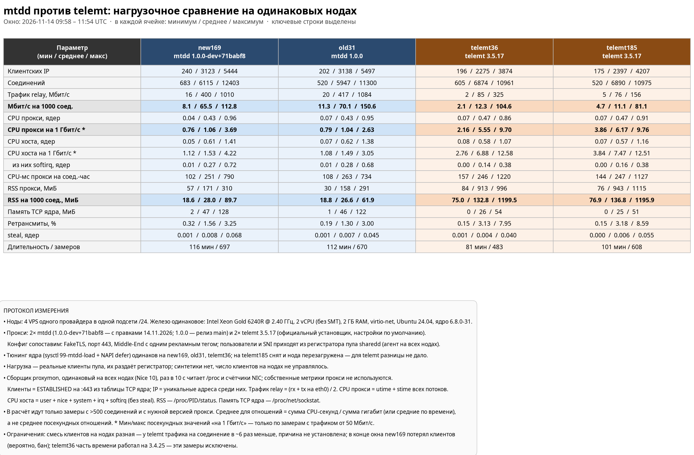

# mtdd и telemt: сравнение на реальной нагрузке

Дата: 14.11.2026, окно 09:58–11:54 UTC (около двух часов).
Сравниваются mtdd `1.0.0-dev+71babf8`, mtdd `1.0.0` (релиз `main`) и
telemt 3.5.17. Нагрузка — реальные клиенты пула sharedd, синтетики нет.



## Коротко

| Показатель (среднее за окно) | mtdd (обе ноды) | telemt 3.5.17 (обе ноды) | Разница |
| --- | --- | --- | --- |
| CPU прокси на 1 Гбит/с | 1.04–1.06 ядра | 5.55–6.17 ядра | telemt в 5.3–5.9 раза дороже |
| RSS на 1000 соединений | 26.6–28.0 МиБ | 132.8–136.8 МиБ | telemt в ~5 раз больше |
| Трафик на 1000 соединений | 65.5–70.1 Мбит/с | 11.1–12.3 Мбит/с | через telemt в 5–6 раз меньше |
| CPU прокси, всего | 0.43 ядра | 0.47 ядра | почти равно |
| Ретрансмиты TCP | 1.30–1.56 % | 3.13–3.18 % | у telemt вдвое больше |

При одинаковом трафике около 300 Мбит/с и сопоставимом числе соединений
telemt тратил примерно **вдвое больше CPU** и **в 2.5–3 раза больше памяти**
(см. [ниже](#один-и-тот-же-трафик-300-мбитс)). Средние отношения выглядят
хуже (в 5–6 раз), потому что telemt почти всё время работал на малом трафике,
где цена соединений не размазывается по гигабитам.

Новая сборка mtdd (`1.0.0-dev`) по CPU и памяти совпадает с релизом `1.0.0`
в пределах шума: 1.06 против 1.04 ядра на Гбит/с, 28.0 против 26.6 МиБ на
1000 соединений. Ухудшения от правок 14.11 не обнаружено.

## Стенд

| Нода | Прокси | Ядро: тюнинг |
| --- | --- | --- |
| new169 | mtdd 1.0.0-dev+71babf8 | sysctl 99-mtdd-load + NAPI defer |
| old31 | mtdd 1.0.0 | sysctl 99-mtdd-load + NAPI defer |
| telemt36 | telemt 3.5.17 | sysctl 99-mtdd-load + NAPI defer |
| telemt185 | telemt 3.5.17 | без тюнинга (снят, нода перезагружена) |

- **Железо одинаковое:** четыре VPS одного провайдера в одной
  подсети /24; Intel Xeon Gold 6240R @ 2.40 ГГц, 2 vCPU без SMT, 2 ГБ RAM,
  virtio-net; Ubuntu 24.04, ядро 6.8.0-31. steal в среднем ≤ 0.008 ядра.
- **Конфиг сопоставим:** одинаковый FakeTLS-домен, порт 443, Middle-End с
  одним рекламным тегом. Пользователи и SNI приходят из регистратора пула
  sharedd; агент пула стоит на всех нодах и тратит ~0.01–0.02 ядра.
- **mtdd** поставлен официальным установщиком из `main`; на new169 бинарник
  заменён на сборку `dev`. **telemt** поставлен официальным установщиком с
  настройками по умолчанию.
- **Тюнинг ядра.** Установщик mtdd ставит sysctl и отложенные прерывания
  сетевой карты; те же настройки скопированы на telemt36, чтобы ни у кого не
  было форы. На telemt185 тюнинг снят полностью: за 30 минут telemt с ним и
  без него дал одинаковые цифры (10.0 и 10.6 Мбит/с на 1000 соединений,
  5.97 и 5.96 ядра на Гбит/с), то есть настройки на telemt не влияют.

## Протокол измерения

Сборщик `tools/proxymon/collect.py` одинаков на всех нодах. Он работает
службой systemd с `Nice=10` и раз в 10 секунд читает только данные ОС —
собственные метрики прокси не используются, потому что у mtdd и telemt они
определены по-разному.

| Величина | Источник |
| --- | --- |
| Соединения | ESTABLISHED с локальным портом 443 из `/proc/net/tcp{,6}` |
| Клиентские IP | уникальные удалённые адреса среди этих соединений, в моменте |
| Трафик relay | (rx + tx на eth0) / 2: каждый пересланный байт входит и выходит |
| CPU прокси | utime + stime всех потоков процесса, `/proc/PID/stat` |
| CPU хоста | user + nice + system + irq + softirq из `/proc/stat`, без steal |
| RSS | `/proc/PID/status` |
| Память TCP ядра | `/proc/net/sockstat` |
| Ретрансмиты | RetransSegs / OutSegs из `/proc/net/snmp` |

Правила обработки:

- в расчёт идут только замеры с **больше чем 500 соединений** и с нужной
  версией прокси (telemt36 часть времени работал на 3.4.25 — эти замеры
  исключены);
- **средние отношения** считаются по суммам за окно (сумма CPU-секунд /
  сумма гигабит), а не как среднее посекундных отношений, иначе простой
  раздувает результат;
- минимум и максимум «на 1 Гбит/с» — только по замерам с трафиком от
  50 Мбит/с.

Сводку можно повторить:

```sh
cd tools/proxymon
python3 report.py pull new169=root@NODE_new169 old31=root@NODE_old31 \
  telemt36=root@NODE_telemt36 telemt185=root@NODE_telemt185
python3 report.py summary --hours 3
python3 report.py bins --by relay
python3 render.py out.png "new169:-:mtdd 1.0.0-dev+71babf8" \
  "old31:-:mtdd 1.0.0:mtdd 1.0.0" \
  "telemt36:-:telemt 3.5.17:telemt 3.5.17" \
  "telemt185:-:telemt 3.5.17"
```

## Результаты

### Средние за окно

| Нода | Минут | Мбит/с на 1000 соед. | CPU на Гбит/с | RSS на 1000 соед. | Средняя нагрузка |
| --- | --- | --- | --- | --- | --- |
| new169 (mtdd dev) | 116 | 65.5 | 1.06 | 28.0 МиБ | 6115 соед., 400 Мбит/с |
| old31 (mtdd 1.0.0) | 112 | 70.1 | 1.04 | 26.6 МиБ | 5947 соед., 417 Мбит/с |
| telemt36 (3.5.17) | 81 | 12.3 | 5.55 | 132.8 МиБ | 6874 соед., 85 Мбит/с |
| telemt185 (3.5.17) | 101 | 11.1 | 6.17 | 136.8 МиБ | 6890 соед., 76 Мбит/с |

Полные минимум / среднее / максимум по всем параметрам — на картинке выше.

### CPU на гигабит зависит от трафика

Часть CPU уходит на обслуживание соединений (рукопожатия, таймеры,
keepalive), и при большом трафике она делится на большее число гигабит.
Поэтому одно число «ядер на Гбит/с» без указания трафика мало что говорит:

| | Пик (~1 Гбит/с у mtdd) | Среднее за окно | Малый трафик (~50 Мбит/с) |
| --- | --- | --- | --- |
| mtdd | 0.76–0.79 | 1.04–1.06 | до 2.6–3.7 |
| telemt | 2.16–3.86 | 5.55–6.17 | до 9.7–9.8 |

Даже лучший момент telemt в 2–3 раза хуже среднего у mtdd.

### Один и тот же трафик: 300 Мбит/с

Единственный раз telemt поднялся выше 151 Мбит/с — один 10-секундный замер
325 Мбит/с в 11:24:48, сразу после перезапуска (волна переподключений).
Ближайший аналог у mtdd — old31 в 10:03–10:04, тоже свежий старт:

| | telemt36 (3.5.17) | old31 (mtdd 1.0.0) | new169 (mtdd dev) |
| --- | --- | --- | --- |
| Трафик | 325 Мбит/с | 297–341 Мбит/с | 304–305 Мбит/с |
| Соединений / IP | 3108 / 790 | 2201–2731 / 835–1057 | 3874–4018 / 1855–1927 |
| CPU прокси | 0.70 ядра | 0.32–0.34 ядра | 0.34–0.36 ядра |
| CPU на Гбит/с | 2.16 | 1.01–1.09 | 1.13–1.17 |
| CPU хоста | 0.94 ядра | 0.41–0.46 ядра | 0.47–0.48 ядра |
| softirq | 0.38 ядра | 0.17–0.19 ядра | 0.20 ядра |
| RSS | 237 МиБ | 66–92 МиБ | 122–129 МиБ |

Медианы mtdd по всем замерам 250–350 Мбит/с (около 5100 соединений):
new169 — 0.37 ядра (1.21 на Гбит/с, 84 замера), old31 — 0.34 ядра
(1.16 на Гбит/с, 57 замеров). Со стороны telemt это один замер: устоявшегося
режима telemt на 300 Мбит/с на стенде не было.

### Память

RSS telemt растёт со временем и после ухода клиентов не возвращается:
утром на telemt36 было 968 МиБ при 1067 соединениях. К концу окна telemt
занимал до 1.1 ГБ из 2 ГБ, mtdd — до 310 МиБ. Поэтому для telemt осмысленна
средняя память на соединение, а не прирост на 1000 соединений.

### telemt 3.4.25

На telemt36 на 23 минуты ставилась версия 3.4.25. Трафика на соединение у
неё было немного больше (14.8 против 10.8–12.3 Мбит/с на 1000), CPU на
гигабит чуть меньше (4.94), но обрывов «Telegram handshake timeout» —
7957 за 5 минут против 147 у 3.5.17, и клиентских IP вдвое меньше. Малый
трафик на соединение есть и в старой ветке telemt, это не регрессия 3.5.

## Не справился ли telemt с нагрузкой?

Гипотеза: telemt не справлялся с нагрузкой и замедлял клиентов. Данные
подтверждают её только частично.

**Против «не хватило ресурсов»:**

- CPU не был узким местом: в среднем 0.47 ядра процесса и 0.57–0.58 ядра
  хоста из двух, максимум 0.91 и 1.16 соответственно. Насыщения CPU не
  было ни в одном замере.
- Память — 0.9–1.1 ГБ из 2 ГБ: много, но до нехватки и свопа не дошло.

**За «telemt медлил клиентов»:**

- При сопоставимом числе соединений (6–7 тысяч) через telemt шло в 5–6 раз
  меньше трафика. Клиенты одни и те же — из одного пула, в той же подсети,
  с теми же блокировками.
- Ретрансмитов TCP у telemt вдвое больше (3.1 % против 1.3–1.6 %), пики до
  8.6 % против 3.3 %.
- Единственный момент, когда через telemt прошло 325 Мбит/с, — волна
  переподключений: свежие соединения качали, пока их было мало.

Вывод: telemt не упирался в CPU или память, но пропускал через каждое
соединение заметно меньше данных. Это похоже на ограничение внутри telemt —
буферы, управление потоком к Middle-End, планировщик справедливости, — а не
на нехватку ресурсов машины. Окончательно отличить «клиенты качают медленно»
от «telemt держит много пустых соединений» по этим данным нельзя: нужно
распределение соединений по возрасту и переданным байтам. Это следующий шаг
для `proxymon`.

## Ограничения

- Около двух часов данных, реальные клиенты; число клиентов на нодах не
  управлялось, смесь клиентов различалась.
- Под конец окна new169 потерял большую часть клиентов (вероятно, бан); все
  ноды в одной /24, поэтому блокировки действуют на оба прокси одинаково.
- Пиковые значения telemt — единичные замеры.
- Один провайдер и одна модель CPU; на других платформах соотношение может
  отличаться.
